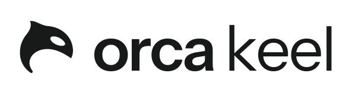

<p align="center">
  <picture>
    <source media="(prefers-color-scheme: dark)" srcset="brand/kit/lockups/orca-keel-lockup-chalk.svg">
    
  </picture>
</p>

# Orca Keel: landing page

The public landing page for Orca Keel, the household computer: a quiet computer that keeps the house in order. The product itself is in development and lives elsewhere; this repository holds what people see around it.

*A quiet computer that keeps the house in order.*

## Layout

- [`site/`](site/): the static landing page. `index.html`, `favicon.svg`, `robots.txt`. No build step, no JavaScript, no forms.
- [`brand/kit/`](brand/kit/README.md): the Orca brand kit the page is built from (the Signal mark, the Orca Keel lockups, the Harbor palette as `tokens/`, the voice sheet). The kit is canonical for colour, type and words; the page reads from it.
- [`docs/`](docs/README.md): deployment agreement and decision records. Contributors and coding agents start with [PROJECT_BRIEF.md](PROJECT_BRIEF.md) and [CLAUDE.md](CLAUDE.md) (identical to `AGENTS.md`).

## Preview locally

```sh
python3 -m http.server -d site 8000
```

Open `http://localhost:8000`. The page loads Instrument Sans and Newsreader from Google Fonts and falls back to system faces if they are blocked.

## Hosting

GitHub Pages, from the `site/` folder on `main`, through the workflow in [`.github/workflows/pages.yml`](.github/workflows/pages.yml). The custom domain is not chosen yet; see [docs/DEVOPS.md](docs/DEVOPS.md).

## Voice

Public text follows the [voice sheet](brand/kit/voice-sheet.md): short declarative sentences, the specific thing named every time, limits stated as plainly as capabilities, no prices until the pilot.

## Licence

Proprietary. See [LICENSE](LICENSE). The source is public so it can be read and served, not so it can be reused. "Orca", "Orca Keel" and the orca head mark belong to Orca Solutions ([NOTICE](NOTICE)).
